<p align="center"></p>
<h1 align="center">Alexandria 18+</h1>
<p align="center"><strong>18+ personal media library</strong> · Self-hosted · Local-first · Keep your organization and viewing history</p>
<p align="center">
  <a href="LICENSE"></a>
  <a href="#quick-start"></a>
  <a href="#quick-start"></a>
  <a href="#docker"></a>
  <a href="#data-privacy-and-examples"></a>
  <a href="https://github.com/CatalpaShore/Alexandria/stargazers"></a>
</p>
<p align="center"><a href="README.md">简体中文</a> · <strong>English</strong> · <a href="README.ja.md">日本語</a></p>
<p align="center"><a href="#screenshots">Screenshots</a> · <a href="#features-in-detail">Features</a> · <a href="#quick-start">Quick start</a> · <a href="#standalone-non-adult-demo">Non-adult demo</a> · <a href="#sources-and-playback-compatibility">Compatibility</a> · <a href="docs/MIGRATION.md">Migration</a> · <a href="docs/OPERATIONS.md">Configuration</a> · <a href="docs/README.en.md">Documentation</a> · <a href="docs/USER_GUIDE.en.md">Feature guide</a></p>

> **[Try the non-adult live demo →](https://catalpashore.github.io/Alexandria/)** · No installation required. Explore the media wall, search, details, sample playback, subtitles in three languages, topics, and mock personal activity. Importing, transcoding, backups, and model services require self-hosting. Includes only 12 open-film records and original test clips.

> **18+: This project is intended for adults managing their own personal adult media library.** Import only content you have the right to possess and use, and follow the rules applicable where you live. The repository provides no adult films, adult cover images, or download resources. README screenshots and the public demo use real non-adult open-film metadata, CC BY artwork and clearly marked mock viewing records.

Alexandria 18+ brings together a media wall, playback, topics, a Viewing Desk, an optional AI Curator, and a personal viewing journal. This open-source personal media platform combines a black-and-gold interface with existing-library imports, subtitle compatibility, and record preservation when storage locations change.

## Product introduction

https://github.com/user-attachments/assets/548e2b31-65e4-4ec0-9f91-69eb32b58240

**[▶ Watch the English introduction](https://cdn.jsdelivr.net/gh/CatalpaShore/Alexandria@master/client/public/tour/product-tour-en.mp4) · v7 with English narration, captions and chapter labels · 2026-10-27 · about 2 min 18 sec**

[Version and chapters](docs/VIDEO.en.md) · [English captions](client/public/tour/subtitles-en.vtt) · [Full feature guide](docs/USER_GUIDE.en.md) · [中文](README.md) · [日本語](README.ja.md)

## At a glance

- **Browse your library:** poster wall, short-video browsing, search and filters, random discovery, version grouping, and media details.
- **Import an existing collection:** index local drives and mounted NAS folders, read NFO, JSON metadata, artwork, and subtitles, and preserve manual corrections.
- **Watch with subtitles:** direct playback, remuxing, transcoding / HLS, external and embedded text subtitle selection, and character encoding controls.
- **Organize your collection:** topics and relationship graphs, favorites, playlists, highlights, playback progress, profile switching, and statistics.
- **Choose what to watch:** the Viewing Desk uses local records; the Curator can optionally connect to Ollama. Without a model, clearly labeled fixed examples demonstrate the interface.
- **Keep long-term records:** viewing journal, backups, background tasks, ingestion audits, and source migration previews.

Scanning media and importing local metadata do not modify source files. Manual ingestion, renaming, and file organization have separate management controls. Back up before migration; see the [migration guide, in Chinese](docs/MIGRATION.md). The project focuses on organizing, discovering, and watching personal media.

## Screenshots

These are screenshots of the running non-adult demo. Click an image for the full-size version. They contain no real adult cover images, performer photographs, or private paths. The application UI shown is in Chinese.

| Media wall: search, filters, and poster browsing | Curator: fixed examples without a model |
| --- | --- |
| [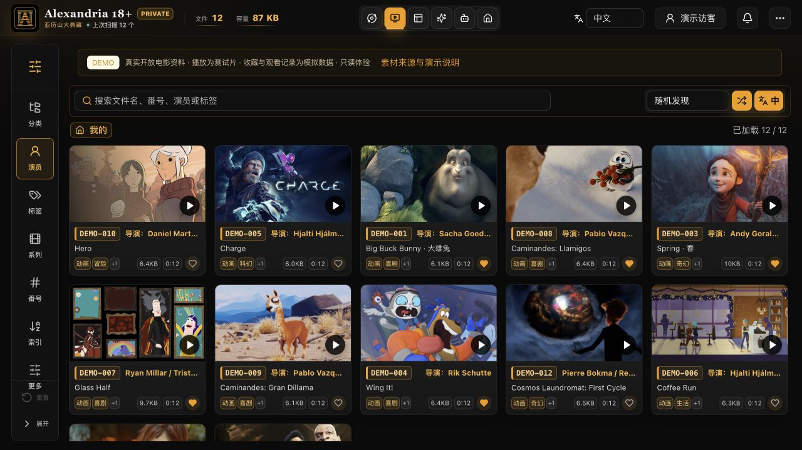](docs/screenshots/media-wall.png) | [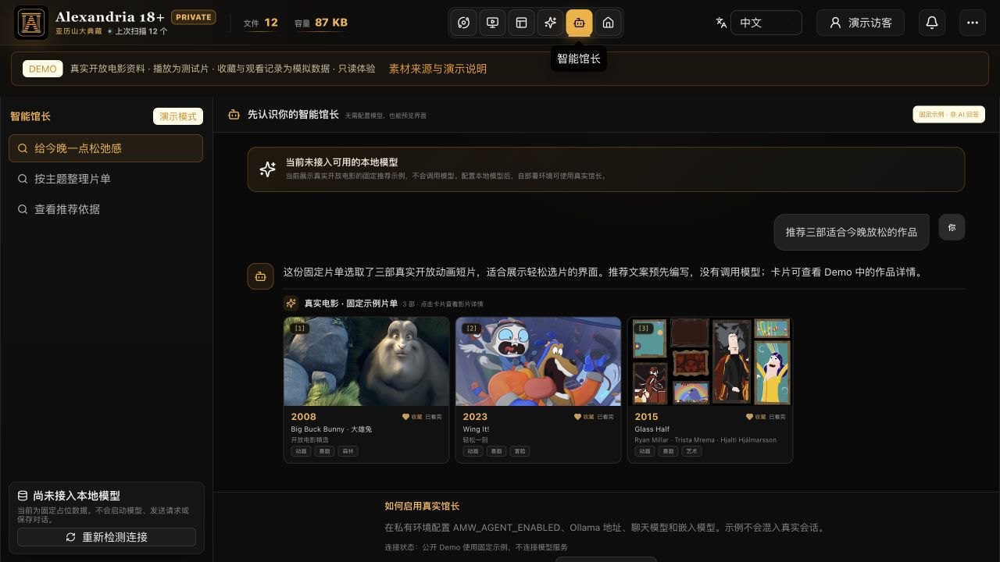](docs/screenshots/curator-demo.png) |
| **Player: subtitles and playback controls** | **Viewing Desk: choose what to watch next** |
| [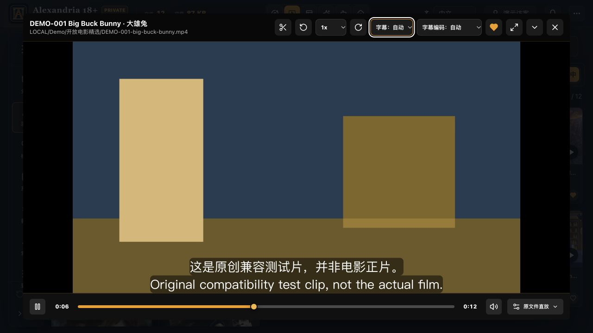](docs/screenshots/player-subtitles.png) | [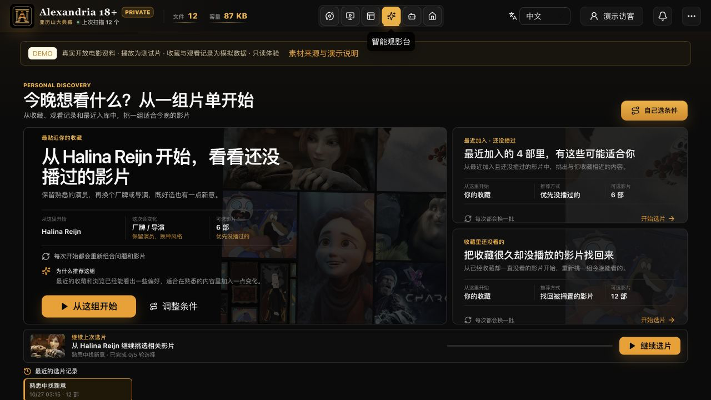](client/public/showcase/viewing-desk.png) |

*Player: a 12-second original compatibility clip with Chinese, English and Japanese demo subtitles and encoding controls. Test clips are not the actual films. Artwork is bundled locally; see the [film asset credits](docs/DEMO_FILMS.md).*

### More interface views

These screenshots use the separate non-adult demo with 12 real open films, licensed artwork and mock viewing records. They show the Chinese UI; the application supports all three interface languages.

| Topics: people, themes, and tags | Title details: metadata, files, and playback |
| --- | --- |
| [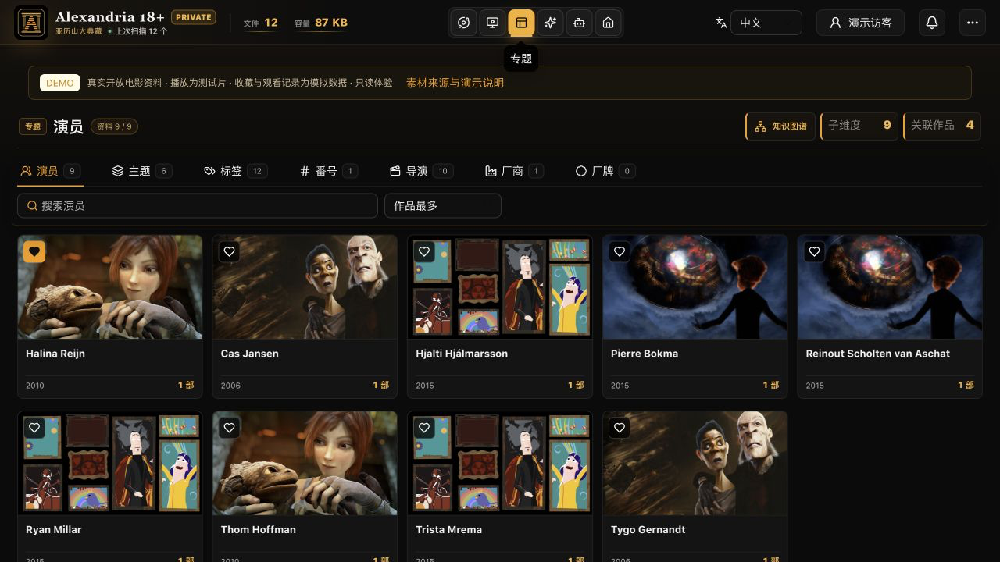](client/public/showcase/topics.png) | [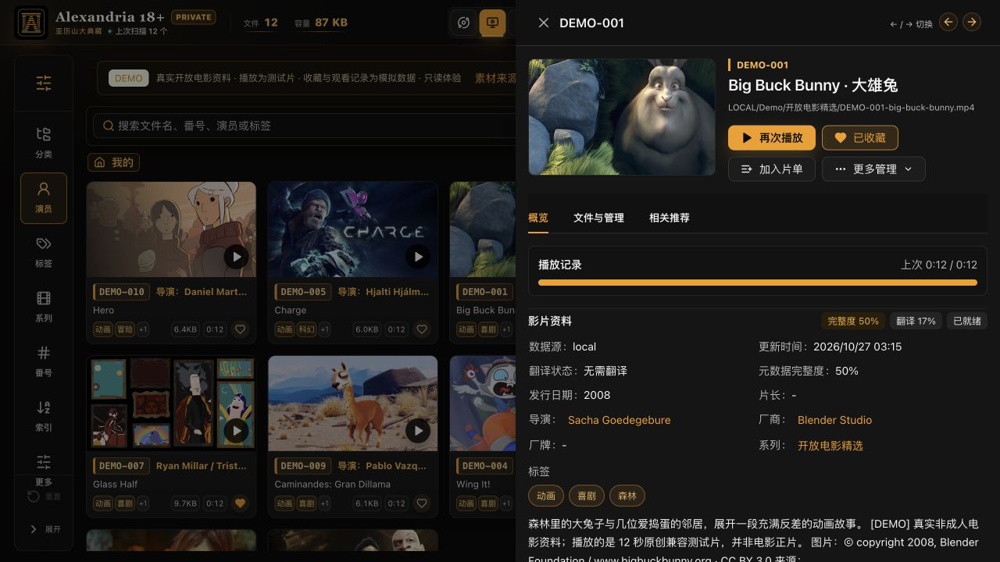](client/public/showcase/media-detail.png) |
| **Knowledge graph: explore connections** | **Personal journal: favorites and viewing history** |
| [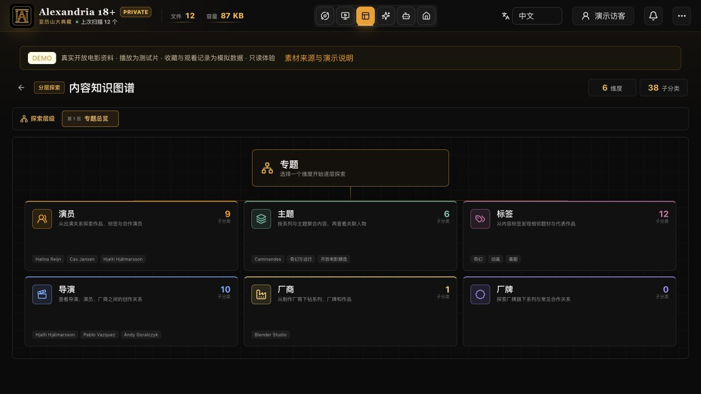](client/public/showcase/knowledge-graph.png) | [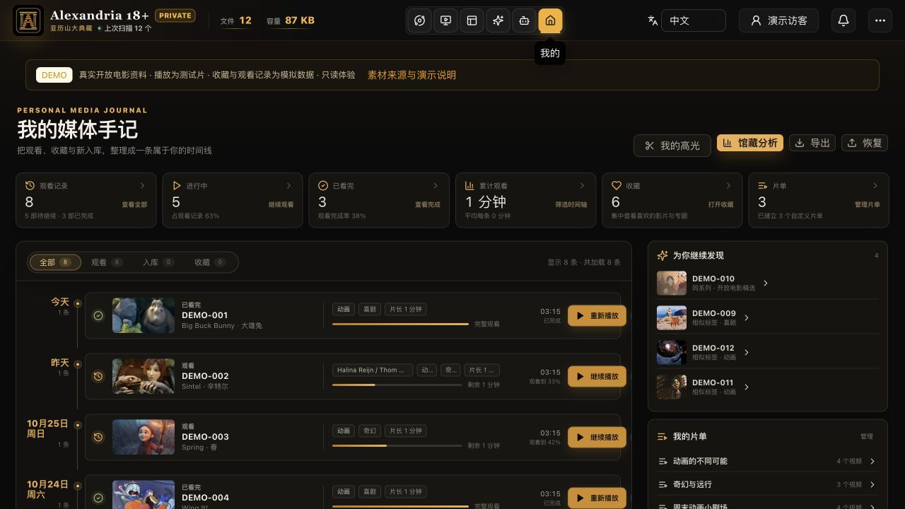](client/public/showcase/personal-library.png) |

**Mobile media wall**

| Media wall | Topics | Viewing Desk | Curator |
| --- | --- | --- | --- |
| [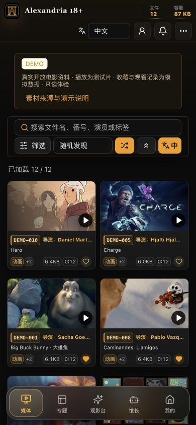](client/public/showcase/mobile-wall.png) | [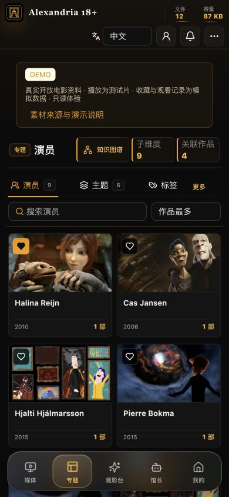](client/public/showcase/mobile-topics.png) | [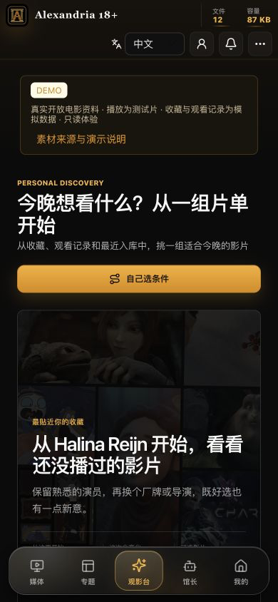](client/public/showcase/mobile-viewing.png) | [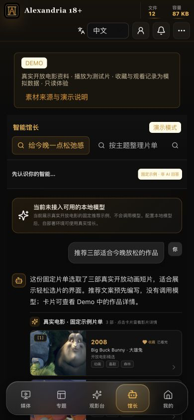](client/public/showcase/mobile-curator.png) |

All images are stored in the repository; select one to view it full size. See the [asset notes, in Chinese](docs/ASSETS.md) for recording sources, redaction coverage, and non-adult demo isolation.

The demo uses factual records from 12 real non-adult open films, with director and voice credits, genres, three playlists, six favorites and eight mock viewing records. Curator responses are preset examples. Open “Sources and demo details” to inspect credits and original film links.

## Features in detail

Use the links under each feature for practical steps, file examples, and troubleshooting, or browse the [documentation index](docs/README.en.md) by task.

### 1. Media wall, search, and multiple versions

- Switch between the poster wall and short-video views. Open a media item for file information, metadata, and playback, or browse the collection at random.
- Filter by performer, genre, director, studio, label, series, catalog-code prefix, source folder, file type, and more. Combine these with favorite and viewing status. Search suggestions can narrow the selection to a work or topic.
- Group multiple files for the same work, then choose the version to play. Grouping changes how items are presented; it does not delete or merge files on disk.

[Step-by-step guide](docs/USER_GUIDE.en.md#media-wall)

### 2. Existing libraries and local metadata

- Add folders on local drives, external disks, or an already mounted NAS without reorganizing the whole collection. Scanning reads file information and builds an index; ordinary scans do not move, rename, or rewrite source files.
- Read adjacent NFO files, `.media.json`, artwork, and subtitles. Matching JSON fields override NFO fields, while existing manual corrections and completed external metadata take precedence, preserving prior organization across rescans.
- Recognize artwork separately from ordinary images so movie posters do not fill the image wall. Metadata management and quality checks help locate missing fields, conflicts, and incorrect file associations. External enrichment services require your own configuration.

[Step-by-step guide](docs/USER_GUIDE.en.md#library-import) · [Local metadata examples](docs/USER_GUIDE.en.md#metadata)

### 3. Playback, subtitles, and progress

- The player keeps playback progress and offers continue-watching entry points. Use direct playback, remuxing, or transcoding / HLS according to the file and browser capabilities. FFmpeg / FFprobe provide media inspection and required conversions.
- Select external SRT, ASS, SSA, or VTT files, or embedded text subtitle tracks in MKV / MP4. Change the character encoding to address garbled text without first rewriting the subtitle file.
- Text subtitles are converted to browser-compatible VTT. Complex ASS / SSA styling and effects are not fully preserved, and image-based subtitles are not supported. Codec, audio-track, and device compatibility still depend on the browser and installed FFmpeg; direct playback is not guaranteed for every file.

[Step-by-step guide](docs/USER_GUIDE.en.md#playback) · [Subtitle tracks and encoding](docs/USER_GUIDE.en.md#subtitles)

### 4. Topics and the knowledge graph

- Explore topics by performer, theme / series, tag, catalog-code prefix, director, studio, or label, then follow related works and other dimensions.
- Search topics and sort them by work count, name, latest update, or random order. The relationship graph helps reveal connections among people, works, and categories.
- Coverage depends on the metadata you import. The public repository does not include a comprehensive performer database or performer photographs. Configure your own reference data and optional external enrichment separately.

[Step-by-step guide](docs/USER_GUIDE.en.md#topics)

### 5. Viewing Desk: choose from local candidates

- The Viewing Desk (观影台) organizes candidates from your local collection, favorites, viewing history, and recent imports. Quick-pick, exploration, favorites, and unwatched entry points work without a language model.
- Refine the selection through topic conditions and pairwise choices. Results are grouped into closest matches (最合口味), something different (换点新意), and adventurous picks (大胆试试).
- Continue a previous session, or reuse and adjust conditions from recent sessions. This local selection flow is separate from the Curator's model-based conversations.

[Step-by-step guide](docs/USER_GUIDE.en.md#viewing-desk)

### 6. Curator: an optional local-model assistant

- Connect to your own Ollama deployment, configure chat and embedding models separately, and load or unload them manually. Use multiple conversations, natural-language search, and `@`, `/`, and `#` controls for entities, intents, and constraints.
- Once configured, retrieve from library metadata, favorites, and viewing records, with source references in recommendation, topic, comparison, and summary cards. Actions that make changes use confirmation cards for review. Check model responses against the cited records.
- **When no model is enabled, the interface shows fixed non-adult examples.** They are explicitly labeled as fixed examples rather than AI responses. They demonstrate the interaction without generating real inference or adding examples to your actual conversations or catalog.
- Model runtimes, model files, and configuration are not bundled. External services are disabled by default. If you configure a remote service address, the relevant queries and context are sent there. See the [configuration guide, in Chinese](docs/OPERATIONS.md).

[Step-by-step guide](docs/USER_GUIDE.en.md#curator)

### 7. Favorites, playlists, and viewing journal

- Organize works into favorites and playlists for planned viewing, regular favorites, or specific themes. Playback progress, continue watching, completion status, and history preserve your viewing records.
- The personal viewing journal (个人媒体手记) brings together recent imports, continue watching, viewing history, completion information, and preference statistics. Delete viewing records or change completion status as needed. It primarily provides a review of viewing data.
- Switch personal profiles to keep separate favorites, progress, playlists, and related state. Profiles do not provide enterprise-style multi-user authorization.

[Step-by-step guide](docs/USER_GUIDE.en.md#personal-library)

### 8. Highlights: keep separate clips

- Choose start and end times in the player, or use the current playback position as a boundary, to create a clip between 1 second and 30 minutes long.
- Generate and store clips separately without rewriting the original video. Once ready, play, loop, or download them, and inspect queued, processing, failed, and retry states.
- Creation requires an available source video, FFmpeg, and a writable clip storage directory. Deleting a highlight removes that clip, not the original work. Include clips you want to keep in your backups.

[Step-by-step guide](docs/USER_GUIDE.en.md#highlights)

### 9. Statistics, ingestion audits, and maintenance

- Metadata quality checks and library statistics help identify gaps in organization. Background-task controls show processing progress and failures.
- Schedule ingestion of local files awaiting organization, then review results, original paths, and destination paths by batch. Rolling back a move depends on the files and paths remaining available. This is not a cloud-drive downloader or a subscription update service.
- Automatic scanning is separate from ingestion and organization actions that move files. Review previews and audit records before operating on a real collection, and keep an independent backup.

[Step-by-step guide](docs/USER_GUIDE.en.md#maintenance)

### 10. Backups, source migration, and offline records

- The backup center supports manual and scheduled backups with configurable destinations and scope. A database snapshot is not a complete collection backup; retain artwork, subtitles, clips, and other separate files as well.
- Preview source changes before replacing disks or mount points. Media IDs are preserved when the source category, name, and relative path remain consistent. Previously established full-file fingerprints help match renamed or moved files; ambiguous duplicates are not merged automatically.
- Disconnected sources retain offline records rather than immediately deleting favorites and viewing history. Database schema updates first create a consistent snapshot; still validate migration on a separate copy. Never let multiple service instances use the same database concurrently.
- Initial full-file fingerprinting may be slow on a large NAS. Full migration of a real collection and large-scale load have not yet been validated. See preparation steps and matching limitations in the [migration guide, in Chinese](docs/MIGRATION.md).

[Step-by-step guide](docs/USER_GUIDE.en.md#backup-migration)

### Where to start

| Goal | Suggested workflow |
| --- | --- |
| Preview the interface and playback | Run the separate non-adult demo; preset favorites, playlists, and history can be viewed, while changes are blocked |
| Import an organized drive / NAS collection | Configure sources → scan local metadata → check quality issues → test playback and subtitles |
| Decide what to watch | Open the Viewing Desk and choose conditions; no language model required |
| Search the collection in natural language | Deploy and configure Ollama, then load the model in the Curator |
| Replace storage or import existing data | Back up all data → use a separate copy → preview source changes → verify records and playback |

### Interface language

Switch between **中文 / English / 日本語** at the top of the home page. Chinese is the default, and the selection is saved in the current browser. Switching does not reset filters, alter library metadata, or change source settings. UI language, subtitle selection, and Chinese / Japanese metadata display are separate controls. Main browsing and action screens use translation catalogs; untranslated maintenance descriptions fall back to Chinese. Titles, performer names, user input, and raw server diagnostics remain in their original language. Supporting technical guides are currently in Chinese unless a translation is linked.

## Quick start

Requires **Node.js 22, pnpm 11.7.0, and FFmpeg / FFprobe**. Run from source. If you already have media, use the connection workflow below; to explore first, run the separate non-adult demo.

```sh
git clone https://github.com/CatalpaShore/Alexandria.git
cd Alexandria
corepack pnpm@11.7.0 install --frozen-lockfile
corepack pnpm@11.7.0 build
corepack pnpm@11.7.0 demo:start
```

Open <http://127.0.0.1:4312> to explore the non-adult demo. To connect your own files, follow the collection workflow below. For development, run `pnpm dev`; the frontend uses port 4311.

### Standalone non-adult demo

Open <http://127.0.0.1:4312>. The demo uses an isolated non-adult film mock library and an in-memory database without reading your personal library configuration. Explore browsing, search, topics, playback, subtitles, and Curator examples. The server blocks favorite and progress writes, directory configuration, imports, exports, file management, and model requests. Preset favorites, playlists, and viewing records are examples; restarting restores them.

See the [demo project guide, in Chinese](demo/README.md) for container startup and deployment limitations. There is no official hosted demo domain yet; repository and deployment links will be added when available.

## Connect an existing collection quickly

For a fresh installation:

```sh
corepack pnpm@11.7.0 install --frozen-lockfile
pnpm doctor
# Read-only preview; repeat --source for multiple mounted folders:
pnpm setup:library --source "/absolute/path/to/media" --dry-run --lang en
# After reviewing paths, create private settings on a fresh installation:
pnpm setup:library --source "/absolute/path/to/media" --write --lang en
pnpm build
pnpm start
```

The script supports `--lang zh-CN|en|ja`. It samples folders and creates configuration without moving, renaming, or modifying media or installing models. Settings live in the ignored runtime directory. Existing databases and source settings are never overwritten.

If the service is running, choose **Connect library → Add folder → Review preview → Back up and start scanning** on the home page. No JSON editing is needed. An empty library shows a three-step guide, while the two-root layout is available under advanced settings.

See the [getting-started guide](docs/GETTING_STARTED.en.md) for directory examples, NAS / Docker setup, and troubleshooting.

## Sources and playback compatibility

| Capability | Current support and limitations |
| --- | --- |
| Local storage and NAS | Multiple locally readable directories (up to 32 in the connection form); mount SMB / NFS / cloud drives in the OS first, and use read-only media volumes in containers |
| Metadata | Matching `.nfo` files (`movie` / `episodedetails`), plus `movie.nfo` in single-video folders; matching `.media.json` overrides NFO by field; existing manual overrides and completed external metadata take precedence |
| Artwork | Matching `-poster` / `.poster` / `.cover`, or `poster` / `folder` / `cover` in single-video folders; JPG / PNG / WebP; artwork is excluded from the ordinary image wall |
| External subtitles | SRT / ASS / SSA / VTT; automatic UTF-8 and UTF-16 BOM detection, with selectable GB18030, Big5, Shift JIS, and Windows-1252 |
| Embedded subtitles | FFprobe lists MKV / MP4 text tracks and FFmpeg extracts them as VTT; image-based subtitles require separate OCR and are not supported here |
| Playback | Direct playback, remuxing, transcoding, and HLS; actual compatibility depends on the browser and FFmpeg codecs; complex ASS / SSA effects are lost in text conversion |
| Storage migration | Preview source changes and back up the database first; consistent sources and relative paths preserve IDs; full fingerprints assist relocation; ambiguous duplicates are not merged automatically |
| Not implemented | Native WebDAV / Emby / Jellyfin connectors, STRM libraries, a dedicated audio library, cloud-drive downloads, and subscription updates |

Mounted-folder support does not imply native protocol support for every cloud drive or media server. Disconnected sources retain records; see the [migration guide, in Chinese](docs/MIGRATION.md) for favorites, progress, and matching limitations.

## Docker

```sh
mkdir -p media .local/docker-data
# On Linux, make the data directory writable by the container's node user (UID 1000).
ALEXANDRIA_MEDIA_DIR=/absolute/path/to/media docker compose up --build -d
```

By default, port 4310 is bound only to the host loopback address. Pairing authentication is enabled in the container; find the pairing code in the local service logs. Media volumes are read-only and the data directory is writable. See the [verification record, in Chinese](docs/VERIFICATION.md) for the current Docker and Android device validation status.

## Data, privacy, and examples

- Media, databases, models, secrets, caches, and private configuration stay out of Git. The default runtime location is `.local/`, and `.env` is also ignored.
- Public source uses generic paths and configurable directories without the developer's username, private disk identifiers, original library paths, or account details.
- README images are limited to the reviewed project icon and non-adult screenshots, checked by SHA-256. Run `pnpm privacy:check` for the release worktree and `pnpm release:check` for the Git index.
- The [adult text metadata examples, documented in Chinese](examples/adult-metadata/README.md) contain only three verified catalog codes, credited names at release, studios, and dates. Display titles are neutral archive labels. Run `pnpm example:adult-metadata` to generate separate test assets in an ignored directory. They contain no original films, original covers, or adult images and are never automatically added to the demo.
- External metadata and model services require your configuration. Once enabled, relevant queries are sent to the configured services; see the [configuration guide, in Chinese](docs/OPERATIONS.md).

## FAQ

**Will the application change my source files?** Ordinary scans, artwork reads, and local metadata imports do not. Manual ingestion and file organization are management actions; review their previews and audit records first.

**Can I use it without a model?** Browsing, playback, and organization work without one. The Curator shows clearly labeled fixed examples. Configure a model to use real conversations, then manually load it before the first conversation.

**Can the provided public demo use real adult content?** It is fixed to reviewed non-adult film records and test clips and has no entry point for importing a personal collection. Personal deployments and public demonstrations use separate data scopes.

**How do I migrate existing data?** Back up the full data set and test on a copy. Schema updates back up the database. Never open the same database with multiple service instances at once. Validate migration against your actual data.

**Does it work on phones?** A responsive interface and Android wrapper source are provided. A self-hosted instance can enable LAN access with pairing authentication. Android device validation and all device / codec combinations have not yet been completed.

## Development and feedback

```sh
pnpm typecheck
pnpm test:unit
pnpm build
pnpm privacy:check
git add .
pnpm release:check
```

Include the version, reproduction steps, expected behavior, and actual behavior in reports. Redact paths, credentials, and LAN addresses. Do not upload private databases, media, or screenshots containing adult images.

Supporting guides, currently in Chinese: [Configuration and usage](docs/OPERATIONS.md) · [Migration](docs/MIGRATION.md) · [Demo project](demo/README.md) · [Example and image sources](docs/ASSETS.md) · [Project scope](docs/SOURCE_BASE.md) · [Verification record](docs/VERIFICATION.md).

## License and acknowledgments

Code authored for this project is licensed under [MIT](LICENSE). Third-party dependencies, models, and media retain their own terms; see [third-party notices](THIRD_PARTY_NOTICES.md). For example, GSAP uses the Standard No Charge terms. See the [asset guide, in Chinese](docs/ASSETS.md) for image and sample sources.
