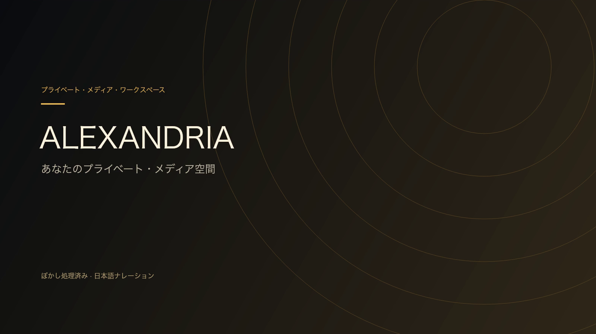

[](https://cdn.jsdelivr.net/gh/CatalpaShore/Alexandria@master/client/public/tour/product-tour-ja.mp4)

# 日本語紹介動画 · v7

[▶ 日本語動画を再生](https://cdn.jsdelivr.net/gh/CatalpaShore/Alexandria@master/client/public/tour/product-tour-ja.mp4) · [日本語字幕](../client/public/tour/subtitles-ja.vtt) · [中文](VIDEO.md) · [English](VIDEO.en.md)

2026-10-27 · 138.15秒 · 1600×900 · H.264 / AAC · 日本語の女性合成音声。

v6 のダウンロードパス全体をぼかした録画を使い、ナレーション、焼き込み字幕、チャプター説明、ジェスチャーの解説を日本語化しています。録画内のアプリ画面は中国語です。中国語 v6 のファイルは変更していません。

カバーは色や大まかな構図がわずかに分かる程度にし、再生映像、個人タイトル、ダウンロードパスは引き続きぼかしています。出演者名、作品識別子、統計が残る場合があります。18歳以上向け個人影庫の操作録画であり、非アダルトデモとは別の素材です。

## チャプター

| 開始 | 機能 | 説明 |
| --- | --- | --- |
| [0:00](https://cdn.jsdelivr.net/gh/CatalpaShore/Alexandria@master/client/public/tour/product-tour-ja.mp4#t=0.000) | ALEXANDRIA | あなたのプライベート・メディア空間 |
| [0:02](https://cdn.jsdelivr.net/gh/CatalpaShore/Alexandria@master/client/public/tour/product-tour-ja.mp4#t=2.267) | メディアウォール · すばやく探す | 検索 / 多角的な絞り込み / カバー表示 |
| [0:06](https://cdn.jsdelivr.net/gh/CatalpaShore/Alexandria@master/client/public/tour/product-tour-ja.mp4#t=6.767) | 作品詳細 · 資料とファイル | 概要 / プレビュー / バージョン / 再生互換性 |
| [0:13](https://cdn.jsdelivr.net/gh/CatalpaShore/Alexandria@master/client/public/tour/product-tour-ja.mp4#t=13.033) | 関連作品 · 興味をたどる | 同じ出演者 / シリーズ / 類似タグ / 並べ替え |
| [0:20](https://cdn.jsdelivr.net/gh/CatalpaShore/Alexandria@master/client/public/tour/product-tour-ja.mp4#t=20.300) | 出演者の詳細 · 人物から作品へ | 人物紹介 / ライブラリの傾向 / 関連作品 |
| [0:25](https://cdn.jsdelivr.net/gh/CatalpaShore/Alexandria@master/client/public/tour/product-tour-ja.mp4#t=25.300) | 特集 · コレクションを体系化 | テーマの情報 / 関連作品 / 続けて探索 |
| [0:30](https://cdn.jsdelivr.net/gh/CatalpaShore/Alexandria@master/client/public/tour/product-tour-ja.mp4#t=30.300) | 知識グラフ · 関係をたどる | 出演者 → タグと作品 / ノードを掘り下げる |
| [0:37](https://cdn.jsdelivr.net/gh/CatalpaShore/Alexandria@master/client/public/tour/product-tour-ja.mp4#t=37.300) | プレイヤー · 操作をひとつに | 再生位置 / 速度 / 音量 / 再生方法 |
| [0:42](https://cdn.jsdelivr.net/gh/CatalpaShore/Alexandria@master/client/public/tour/product-tour-ja.mp4#t=42.300) | ハイライト編集 · 見返す場面を指定 | 開始・終了 / 範囲調整 / この録画では生成を実行しません |
| [0:48](https://cdn.jsdelivr.net/gh/CatalpaShore/Alexandria@master/client/public/tour/product-tour-ja.mp4#t=48.300) | モバイル · ジェスチャーで快適に | レスポンシブ表示とポインター操作。スマートフォン実機の録画ではありません |
| [0:58](https://cdn.jsdelivr.net/gh/CatalpaShore/Alexandria@master/client/public/tour/product-tour-ja.mp4#t=58.300) | マイハイライト · 保存して見返す | 元の作品 / 長さ / 状態 / 再生 |
| [1:02](https://cdn.jsdelivr.net/gh/CatalpaShore/Alexandria@master/client/public/tour/product-tour-ja.mp4#t=62.800) | 視聴デスク · 候補を比較 | 並べて選択 / ラウンドの進捗 / モデル性能のベンチマークではありません |
| [1:07](https://cdn.jsdelivr.net/gh/CatalpaShore/Alexandria@master/client/public/tour/product-tour-ja.mp4#t=67.800) | AI館長 · ローカルモデルに質問 | 実際の入力・送信・回答生成 |
| [1:12](https://cdn.jsdelivr.net/gh/CatalpaShore/Alexandria@master/client/public/tour/product-tour-ja.mp4#t=72.067) | 実際の回答 · モデルの出力を保持 | 実際の回答を使用。推論の待ち時間は短縮しています |
| [1:17](https://cdn.jsdelivr.net/gh/CatalpaShore/Alexandria@master/client/public/tour/product-tour-ja.mp4#t=77.067) | 続けて質問 · 文脈を引き継ぐ | 同じ会話 / 文脈 / 続きの回答 |
| [1:21](https://cdn.jsdelivr.net/gh/CatalpaShore/Alexandria@master/client/public/tour/product-tour-ja.mp4#t=81.567) | マイページ · お気に入りと視聴履歴 | お気に入り / プレイリスト / 視聴タイムライン |
| [1:26](https://cdn.jsdelivr.net/gh/CatalpaShore/Alexandria@master/client/public/tour/product-tour-ja.mp4#t=86.067) | ライブラリ分析 · 全体をひと目で | 規模 / 構成 / データの信頼性 |
| [1:30](https://cdn.jsdelivr.net/gh/CatalpaShore/Alexandria@master/client/public/tour/product-tour-ja.mp4#t=90.067) | 時間の流れ · 積み重ねを可視化 | 年別の分布 / 月別ヒートマップ / 取り込みの推移 |
| [1:34](https://cdn.jsdelivr.net/gh/CatalpaShore/Alexandria@master/client/public/tour/product-tour-ja.mp4#t=94.067) | コンテンツ分析 · 構造を理解 | 関連人物・組織の分布 / タグ / クロス分析 |
| [1:38](https://cdn.jsdelivr.net/gh/CatalpaShore/Alexandria@master/client/public/tour/product-tour-ja.mp4#t=98.333) | 技術と保存容量 · ストレージを計画 | 解像度 / コーデック / 形式 / 容量 |
| [1:42](https://cdn.jsdelivr.net/gh/CatalpaShore/Alexandria@master/client/public/tour/product-tour-ja.mp4#t=102.833) | メディア資産 · 処理状況を確認 | タスクの状態 / 派生メディア / 処理効率 |
| [1:46](https://cdn.jsdelivr.net/gh/CatalpaShore/Alexandria@master/client/public/tour/product-tour-ja.mp4#t=106.333) | データ品質 · 不足項目を探す | 項目の充足率 / 問題の特定 |
| [1:49](https://cdn.jsdelivr.net/gh/CatalpaShore/Alexandria@master/client/public/tour/product-tour-ja.mp4#t=109.333) | 自動翻訳 · 字幕と音声認識を管理 | 優先順位と進捗を管理。この環境では音声認識は使用不可、自動処理はオフです |
| [1:57](https://cdn.jsdelivr.net/gh/CatalpaShore/Alexandria@master/client/public/tour/product-tour-ja.mp4#t=117.600) | メタデータツール · 補完と修正 | 状態で絞り込み / 一括補完 / ファイル名の修正 |
| [2:05](https://cdn.jsdelivr.net/gh/CatalpaShore/Alexandria@master/client/public/tour/product-tour-ja.mp4#t=125.100) | 再生互換性 · 問題を確認 | 互換性の状態 / 待機タスク / 処理への入口。新しいタスクは実行しません |
| [2:10](https://cdn.jsdelivr.net/gh/CatalpaShore/Alexandria@master/client/public/tour/product-tour-ja.mp4#t=130.367) | 自動取り込み · 設定と履歴を追跡 | 定時実行 / バッチ履歴 / 問題の追跡。ダウンロードパスはぼかし処理済み |
| [2:15](https://cdn.jsdelivr.net/gh/CatalpaShore/Alexandria@master/client/public/tour/product-tour-ja.mp4#t=135.367) | 見つける。観る。整理する。 | ALEXANDRIA · プライベート・メディア空間 |

## 実演の範囲

設定済みの環境を使った録画です。AI館長や自動処理には別途サービス設定が必要です。表示環境では音声認識が利用できず、自動処理はオフで、新しいタスクは実行していません。モデルの実際の回答を使用し、推論待ちは編集で短縮しています。VS は視聴候補の比較であり、モデル性能のベンチマークではありません。

モバイル部分はレスポンシブ表示とポインター操作の説明で、スマートフォン実機の録画ではありません。長押しの一時的な3倍速は機能説明であり、実機の長押し操作を撮影したものではありません。この言語版の制作でハイライト生成、翻訳、変換、取り込みのタスクは実行していません。

通常のセルフホスト環境では、表示言語に合わせて動画、ポスター、字幕を切り替え、再生位置を引き継ぎます。非アダルトデモでは動画を表示せず、直接アクセスや HEAD を含む /tour 全体を拒否します。

## ファイルのチェックサム

```text
b784d2f78435a1c10dca718dcc19a763e556acd054d00caeedc502b88827674a
```

[機能の使い方](USER_GUIDE.ja.md) · [素材の出典とぼかし範囲（中国語）](ASSETS.md)
