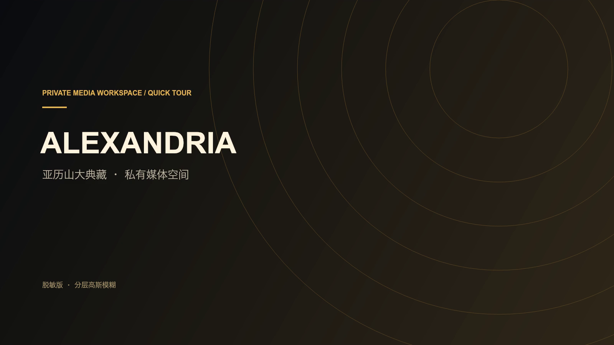

[▶ 播放最新介绍视频：v6 路径补充脱敏版 · 2026-10-27](https://cdn.jsdelivr.net/gh/CatalpaShore/Alexandria@master/client/public/tour/product-tour.mp4) · [中文字幕](../client/public/tour/subtitles-zh.vtt)

# 介绍视频与功能章节

[中文文档](README.md) · [English docs](README.en.md) · [日本語ドキュメント](README.ja.md)

## 语言版本

| 版本 | 视频 | 字幕与章节 |
| --- | --- | --- |
| 中文 v6 | [中文配音](https://cdn.jsdelivr.net/gh/CatalpaShore/Alexandria@master/client/public/tour/product-tour.mp4) | [中文字幕](../client/public/tour/subtitles-zh.vtt)，章节见下表 |
| English v7 | [English narration](https://cdn.jsdelivr.net/gh/CatalpaShore/Alexandria@master/client/public/tour/product-tour-en.mp4) | [English captions](../client/public/tour/subtitles-en.vtt) · [English chapters](VIDEO.en.md) |
| 日本語 v7 | [日本語ナレーション](https://cdn.jsdelivr.net/gh/CatalpaShore/Alexandria@master/client/public/tour/product-tour-ja.mp4) | [日本語字幕](../client/public/tour/subtitles-ja.vtt) · [日本語チャプター](VIDEO.ja.md) |

英日版本在 v6 路径补充脱敏素材上本地化配音、字幕、章节标题和手势说明，实录界面仍为中文。中文成片保持不变；普通自部署的介绍页随界面语言选择对应视频，切换时保留播放位置。非成人 Demo 仍不加载这些录像。

当前引用 **2026-10-27 制作的 v6 路径补充脱敏版**，138.15 秒，中文配音，1600×900，H.264 / AAC。已核对制作目录中的最新成片，仓库副本与该文件的 SHA-256 一致：

~~~text
b105527f470878b7565120a82edab732098cea6e41c2beb33957e4b38f46dfa4
~~~

此版在封面、播放画面和私人文字遮挡的基础上，补齐整个自动入库章节的两行下载路径模糊处理。人物名、作品编号等索引文字可能保留；该视频是 18+ 个人影库的脱敏操作录像，和完全使用非成人素材的公开 Demo 分开。范围说明见[资源说明](ASSETS.md)。

## 按章节看功能

下表链接使用浏览器媒体时间片段。若仓库页面未按时间跳转，先通过“播放最新介绍视频”打开原始 MP4，再拖动到对应时间。详细指南提供可跟随操作的文字步骤。

| 起始时间 | 内容 | 详细步骤 |
| --- | --- | --- |
| [0:02](https://cdn.jsdelivr.net/gh/CatalpaShore/Alexandria@master/client/public/tour/product-tour.mp4#t=2.25) | 搜索与多维筛选 | [媒体墙](USER_GUIDE.md#media-wall) |
| [0:07](https://cdn.jsdelivr.net/gh/CatalpaShore/Alexandria@master/client/public/tour/product-tour.mp4#t=6.75) | 作品详情、预览与文件版本 | [作品与版本](USER_GUIDE.md#media-wall) |
| [0:13](https://cdn.jsdelivr.net/gh/CatalpaShore/Alexandria@master/client/public/tour/product-tour.mp4#t=13) | 关联作品 | [专题探索](USER_GUIDE.md#topics) |
| [0:20](https://cdn.jsdelivr.net/gh/CatalpaShore/Alexandria@master/client/public/tour/product-tour.mp4#t=20.25) | 人物详情、专题与知识图谱 | [关系探索](USER_GUIDE.md#topics) |
| [0:37](https://cdn.jsdelivr.net/gh/CatalpaShore/Alexandria@master/client/public/tour/product-tour.mp4#t=37.25) | 播放控制 | [播放与字幕](USER_GUIDE.md#playback) |
| [0:42](https://cdn.jsdelivr.net/gh/CatalpaShore/Alexandria@master/client/public/tour/product-tour.mp4#t=42.25) | 区间标记、手势与高光回看 | [精彩片段](USER_GUIDE.md#highlights) |
| [1:03](https://cdn.jsdelivr.net/gh/CatalpaShore/Alexandria@master/client/public/tour/product-tour.mp4#t=62.75) | 候选对比 | [观影台](USER_GUIDE.md#viewing-desk) |
| [1:08](https://cdn.jsdelivr.net/gh/CatalpaShore/Alexandria@master/client/public/tour/product-tour.mp4#t=67.75) | 本地馆长与连续追问 | [馆长与模型](USER_GUIDE.md#curator) |
| [1:22](https://cdn.jsdelivr.net/gh/CatalpaShore/Alexandria@master/client/public/tour/product-tour.mp4#t=81.5) | 收藏、片单和观看轨迹 | [个人记录](USER_GUIDE.md#personal-library) |
| [1:26](https://cdn.jsdelivr.net/gh/CatalpaShore/Alexandria@master/client/public/tour/product-tour.mp4#t=86) | 影库分析、任务和字段覆盖 | [统计与维护](USER_GUIDE.md#maintenance) |
| [1:49](https://cdn.jsdelivr.net/gh/CatalpaShore/Alexandria@master/client/public/tour/product-tour.mp4#t=109.25) | 字幕与语音识别管线 | [字幕](USER_GUIDE.md#subtitles) · [维护](USER_GUIDE.md#maintenance) |
| [1:58](https://cdn.jsdelivr.net/gh/CatalpaShore/Alexandria@master/client/public/tour/product-tour.mp4#t=117.5) | 元数据管理 | [本地资料](USER_GUIDE.md#metadata) |
| [2:05](https://cdn.jsdelivr.net/gh/CatalpaShore/Alexandria@master/client/public/tour/product-tour.mp4#t=125) | 播放兼容中心 | [兼容处理](USER_GUIDE.md#playback) |
| [2:10](https://cdn.jsdelivr.net/gh/CatalpaShore/Alexandria@master/client/public/tour/product-tour.mp4#t=130.25) | 自动入库与审计 | [任务与维护](USER_GUIDE.md#maintenance) |

录像展示已配置环境中的操作，不代表首次安装已具备外部服务或模型。移动端片段展示响应式布局；新部署按[上手指南](GETTING_STARTED.md)准备，并以实际运行结果为准。

普通自部署的“产品介绍”可直接播放该录像。非成人 Demo 对整个 **/tour** 路径返回 404，保留非成人截图展示；文档链接用于单独查看脱敏录像，不改变 Demo 的内容边界。
